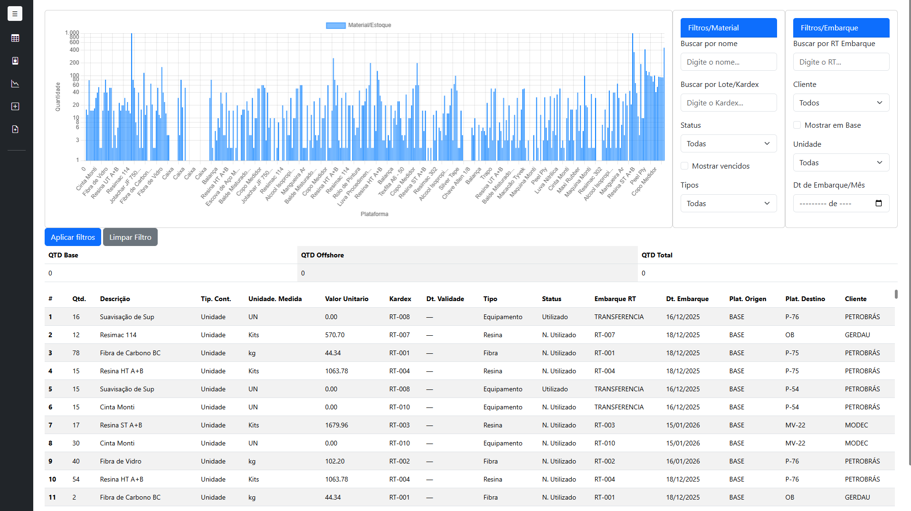

# Estoc-TISI



Sistema web de controle de estoque e embarques da TISI. Permite cadastrar materiais, acompanhar as quantidades por plataforma (Base, Offshore e Total), registrar embarques e cautelas, e visualizar o estoque em gráfico.

> **Status:** descontinuado. Foi a evolução do projeto [EsToc](https://github.com/JuhhSobrinho/EsToc) e serve de referência de autenticação e CRUD com Supabase.

## Funcionalidades

- Gráfico de barras com a quantidade de material em estoque, por plataforma
- Filtros de material: busca por nome, lote/kardex, status (utilizado ou não) e tipo, com opção de mostrar itens vencidos
- Filtros de embarque: busca por RT de embarque, cliente, unidade (base ou offshore) e data de embarque/mês
- Tabela com quantidade, descrição, unidade de medida, valor unitário, kardex, validade, tipo, status, RT de embarque, datas e plataformas de origem e destino
- Totais de quantidade em Base, Offshore e Total
- Cadastro de plataformas, materiais, funcionários e formulários
- Registro de embarques e de cautelas de material
- Vinculação de funcionários a embarques

## Tecnologias

- **Back-end:** Node.js, Express 5, `@supabase/supabase-js`
- **Banco de dados e autenticação:** Supabase (PostgreSQL)
- **Front-end:** HTML, CSS e JavaScript puro, com módulos em `client/scripts`
- **Utilitários do terminal:** chalk e figlet (usados na mensagem de inicialização do servidor)

## Estrutura

```
Estoc-TISI/
├── client/                  # Front-end estático
│   ├── index.html
│   ├── scripts/             # Componentes (cadastro, abas, gráfico, formulários)
│   └── view/                # Páginas (cadastro, formulário, gráfico, abas) e estilos
├── server/
│   ├── server.js            # Ponto de entrada (porta 8104)
│   ├── app.js
│   ├── config/config.js     # Conexão com o Supabase
│   ├── controller/          # Regras de cada entidade
│   └── routes/              # Rotas da API
└── package.json
```

### Principais rotas da API

| Prefixo | Função |
|---|---|
| `/plataformas` | Cadastrar e listar plataformas, buscar por nome e embarques por plataforma |
| `/material-com-embarque` | Materiais com embarque: criar, atualizar, listar por plataforma e validade |
| `/material-embarque` | Vínculo entre material e embarque |
| `/embarque` | Criar e buscar embarques |
| `/formulario` | Criar e consultar formulários |
| `/itens-formulario` | Itens de cada formulário |
| `/funcionario` | Cadastrar, buscar, verificar e atualizar funcionários |
| `/funcionario-embarque` | Vincular funcionários a embarques |
| `/cautela-material` | Registrar cautelas de material |

## Como executar

Pré-requisitos: Node.js instalado e um projeto no Supabase com as tabelas usadas pela API.

```bash
npm install
node server/server.js
```

Depois, abra `http://localhost:8104` no navegador.

Não há script `start` no `package.json`, por isso o comando é `node server/server.js`.

## Observações

- O esquema das tabelas do Supabase não está no repositório. Os nomes de colunas são inferidos do código e precisam ser confirmados no seu projeto (a confirmar).
- A configuração de conexão com o Supabase fica em `server/config/config.js`. Não versione chaves reais: use variáveis de ambiente ou um arquivo fora do Git (a confirmar se a versão atual já lê de variáveis).
- A pasta `node_modules` está versionada no Git. O recomendado é removê-la do repositório e incluí-la no `.gitignore`.
- O projeto está descontinuado, então algumas telas podem estar incompletas ou sem uso atual.

## Autor

Desenvolvido por [Juliano Sobrinho](https://github.com/JuhhSobrinho).
